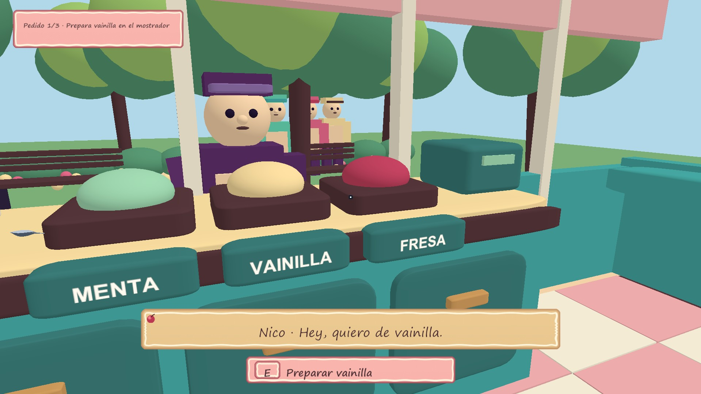
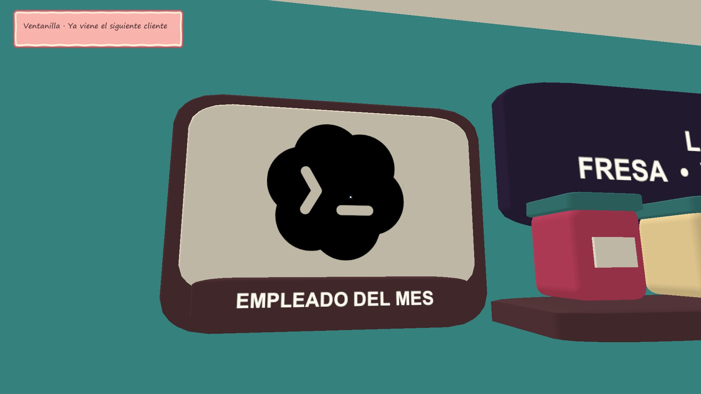
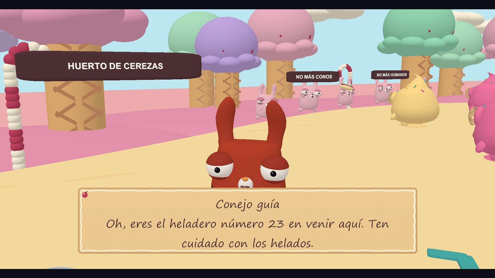
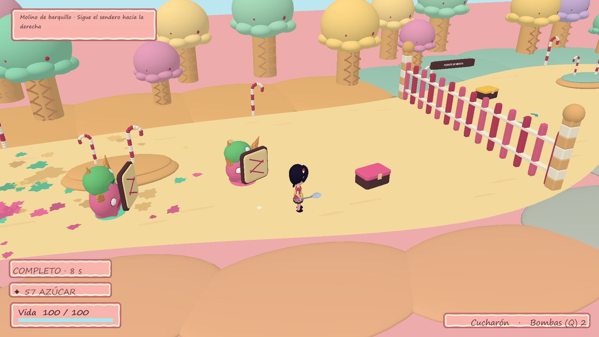
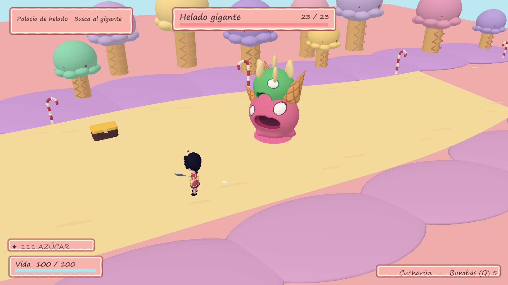
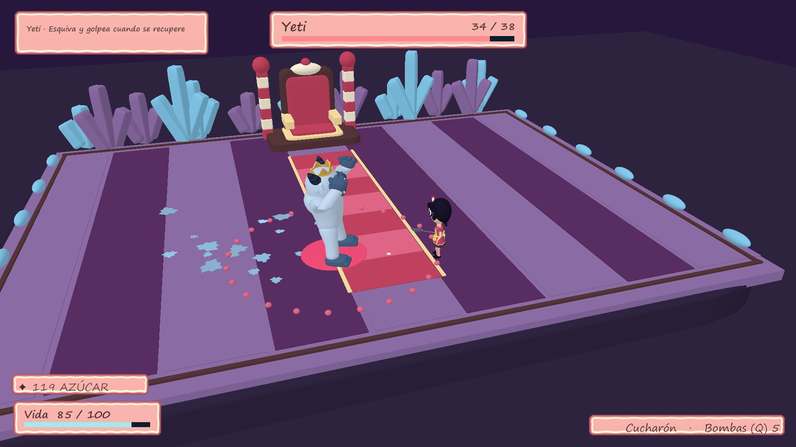

# GameMiners · Hackatón 2026

Proyecto colaborativo del equipo GameMiners para la hackatón de videojuegos. La primera entrega será una prueba técnica para integrar el trabajo de tres computadores en un mismo proyecto Unity, ejecutarlo en el editor y generar una versión jugable.

## La Heladería Maldita en acción

Una partida empieza atendiendo pedidos en la heladería y termina enfrentando a los jefes del mundo de los helados.

| Integrante | Responsabilidad | Rama |
| --- | --- | --- |
| Matías | Coordinación, arquitectura funcional, UX/UI, repositorio e integración | `feature/ui` |
| Nacho | Programación y mecánicas de gameplay | `feature/gameplay` |
| Cami | Dirección artística, dibujo, modelado 3D y recursos visuales | `feature/art` |

Tecnologías del equipo: Unity Hub y Unity Editor, C#, Git y GitHub, GitHub Desktop, Codex y Blender para recursos 3D. Git LFS se usará cuando el equipo acuerde incorporar binarios grandes.

## Primeros pasos

1. Lee [AGENTS.md](AGENTS.md) y [la guía de integración](docs/INTEGRATION.md).
2. Antes de crear el proyecto, el equipo debe confirmar la versión exacta de Unity, incluidos parche y sufijo, y una plantilla compatible con los tres computadores. Matías registra ambos datos en [ARCHITECTURE.md](docs/ARCHITECTURE.md).
3. Cuando se abra la preparación de Unity, Matías crea una única copia desde Unity Hub y publica la base real con `Assets/`, `Packages/`, `ProjectSettings/` y sus configuraciones. El editor exacto queda registrado también en `ProjectSettings/ProjectVersion.txt`.
4. Tras publicar la base, cada integrante clona este repo en GitHub Desktop, instala la versión acordada y agrega el clon a Unity Hub. Para contribuir, acepta primero la invitación al repositorio. Cada rama personal debe partir del mismo commit de preparación.
5. Desarrollo del prototipo pendiente de aprobación explícita de Matías.

Para seguir el trabajo, consulta [diseño](docs/GAME_DESIGN.md), [tareas](docs/TASKS.md) y [pruebas](docs/TESTING.md).

El código original se publica bajo [licencia MIT](LICENSE). Los recursos de terceros conservan las condiciones de su licencia correspondiente.
